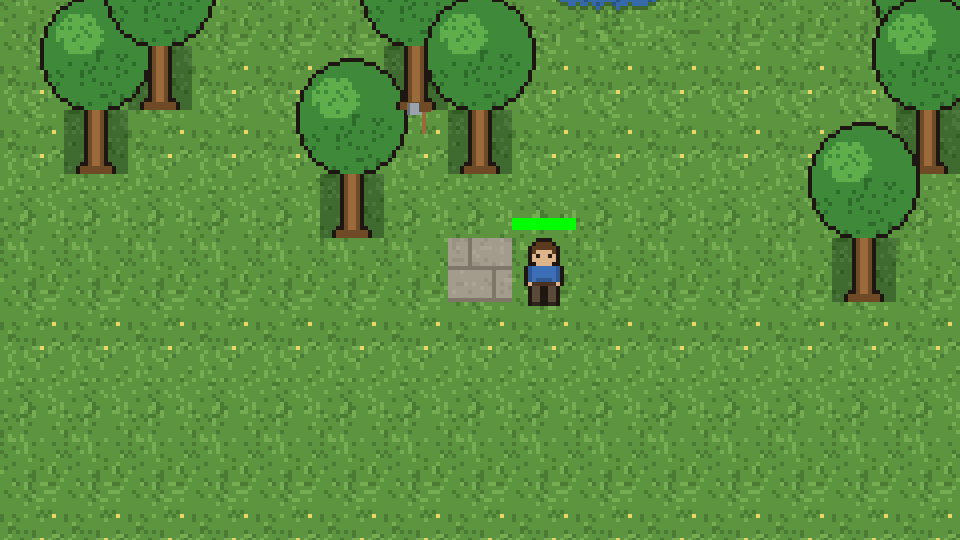
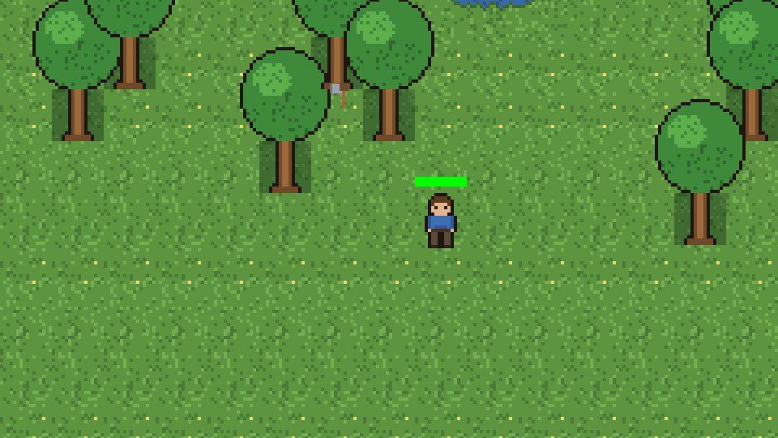
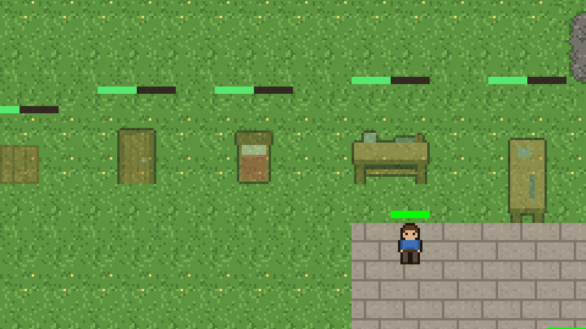
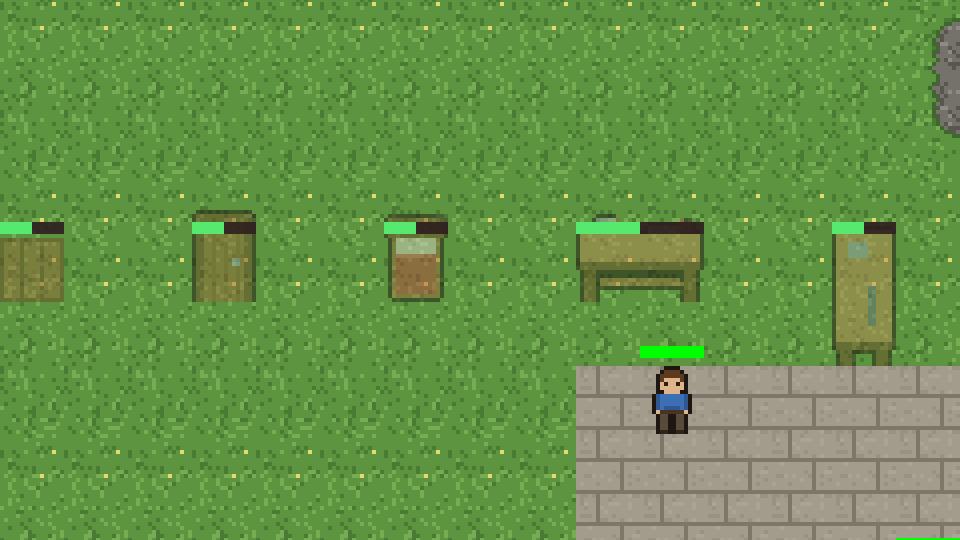

# B4 handoff: construction progress bar offset, wall art under a chopped tree

> **In short:** Two fixes. (1) The progress bar over a construction site used to sit one tile above the
> top of the site's ghost image, so the taller the image, the higher the bar floated. It is now
> placed from the site's tiles: as wide as the footprint, 1 px above its top edge, the same for
> every kind and both workbench orientations. (2) The "wall art" under a chopped tree was a core
> bug, not an atlas bug: `chop` turned the tree tile into `floor`, the built-floor kind that
> the starting clearing uses and that the art draws as stone bricks. Trees only ever generate on
> `soil`, so `chop` now gives the tile back as `soil` and it draws as grass like its neighbours.

## Branch and commits

- Branch: `antonelmejor50-hub/b4-two-visual-bugs-from`. Started on `main` at `347bc31`; after
  the first review it was rebased onto `main` at `4329b3c` (R4 merged, plus a `REVIEW.md`
  rule). The rebase was clean, and `main` was fetched again before this handoff.
- Three commits: "B4: progress bar glued to the site footprint; chop leaves soil, not floor"
  (code, tests, this report, the capture script, the screenshots, the backlog row) and "B4
  review: bar test asserts the literal 1 px gap and 3 px height" plus "B4 review round 1: report
  updated after rebase onto main 4329b3c" (review round 1, below).

## What was wrong and where

### 1. Progress bar offset (viewer)

`map_view.gd` `_draw_construction_sites()` placed the bar at `sprite_top - TILE_SIZE`, where
`sprite_top` is the top of the ghost sprite. Each kind's sprite has a different height and
anchor (wall 16 px, door/bed 24 px, horizontal workbench 28 px, vertical workbench 44 px), so
the bar floated between 1 and 2 tiles above the footprint. Now:

- `construction_site_footprint_rect(site)` (new static function): the pixel rectangle of the
  site's footprint tiles. It is the same size rule the loop had inline (workbench 2×1 or 1×2,
  everything else 1×1), moved out so a test can reach it.
- `construction_bar_rect(footprint_rect)` (new static function): the bar is the footprint's
  width, `CONSTRUCTION_BAR_HEIGHT` (3 px) high, and ends `CONSTRUCTION_BAR_GAP` (1 px) above the
  footprint's top edge. The ghost sprite is no longer an input.

The bar used to be a fixed 32 px wide centred on the footprint; it is now as wide as the
footprint (16 px on a 1×1 site, 32 px on a horizontal workbench, 16 px on a vertical one), so it
stays "over the site tile for 1×1" as the backlog asks. On sprites taller than their tile (door,
bed, workbenches) the bar now overlaps the top of the translucent ghost; that is the requested
"glued to the tile, not to a sprite row".

### 2. Wall art under a chopped tree (core)

I checked both possibilities the backlog lists:

- **Atlas mapping:** correct. `TILE_ATLAS_MAP` maps every kind in `content/tiles.json` to its
  documented cell (`test_tile_atlas_map.gd` already checks every tile kind has a mapping and
  an opaque cell); `floor` maps to `terrain.png` (4,5), which `docs/art/terrain-autotile.md`
  documents as "built floor": stone bricks. No atlas change was needed, so no new atlas test.
- **Core:** `_toil_on_work_complete()` in `world_state.gd` set a chopped tile to `TILE_FLOOR`.
  The contract (`orders-and-movement.md`) said the same (`tree -> floor`), but `floor` is the
  built floor: the starting clearing is made of it and it draws as bricks, so a single brick
  tile appeared in the grass. `world_generator.gd` only places trees on `TILE_SOIL` (line 248:
  `if map[index] == TILE_SOIL: map[index] = TILE_TREE`), so the terrain a tree had underneath is
  always soil. The fix is one line: `chop` now writes `TILE_SOIL`. The rest of the completion
  path is unchanged (dirty cell, water cache, regions/rooms hooks fire because the kind
  changed; one ground wood is still spawned, so chopping yields exactly what it did before).

**About "grass, sand, dirt":** `content/tiles.json` has no sand or dirt tile kind (`sand` is an
item that `dig` spawns), and trees generate only on `soil`, which is the grass terrain. So the
"each terrain" test covers the only terrain a tree can stand on, on three different seeds. If
the owner adds sand/dirt terrains under trees later, the tree tile would have to remember what
it grew on; that is new behaviour for a future task, not this fix.

Side effect, intended: the chopped tile is real soil again, so it can be dug, tilled and
built on like any grass tile (before, `floor` could not be dug or tilled). The new test checks
`till` is accepted there.

## Owned paths and files changed

| File | Change |
| --- | --- |
| `game/scripts/viewer/map_view.gd` | bar placed from the footprint (`construction_site_footprint_rect()`, `construction_bar_rect()`, two constants) |
| `game/scripts/core/world_state.gd` | `chop` completion writes `TILE_SOIL` instead of `TILE_FLOOR` (one line, line count unchanged: 3973 after rebasing onto R4) |
| `game/scripts/tests/test_chop_tile_kind.gd` (+ `.uid`) | **new**: tile kind after a real chop on three seeds |
| `game/scripts/tests/test_construction_bar_offset.gd` (+ `.uid`) | **new**: bar offset for six real sites |
| `game/scripts/tests/test_map_view_cell_contents.gd` | chopped tile expected `soil` and rendered as a grass variant (was `floor`); the run-to-completion loop now waits for the target's kind to change instead of for `floor`/`trench` |
| `game/scripts/tests/test_movement_and_work.gd`, `test_new_game_dig_chop.gd`, `test_new_game_forage_chop.gd`, `test_save_determinism.gd` | expected tile after chop `floor` → `soil` (same assertion, new value; in `test_save_determinism.gd` the four checks of the pending-chop save/load case) |
| `game/scripts/tests/test_toils_dig_chop_regression.gd` | `EXPECTED_HASH` / `COLONY_EXPECTED_HASH` recaptured (see below), reason added to the header's list |
| `docs/architecture/orders-and-movement.md` | contract line for `chop`: `tree -> soil`, with the reason |
| `docs/art/terrain-autotile.md` | one note on the built-floor cell: `floor` is bricks; a chopped tree goes back to `soil` |
| `docs/orca/handoffs/B4.md`, `B4-capture.gd`, `B4-shots/*.png` | this report, the capture script, the screenshots |
| `docs/orca/BACKLOG.md` | B4 status row |

Two files are outside the literal owned-path list, both because the behaviour change requires
them: the tests whose expectation was the old `floor` result (the entry allows "their tests"),
and the `chop` line of the contract `orders-and-movement.md` (AGENTS.md: when behaviour
changes, update the contract). Nothing else.

**Not touched:** `tile_atlas_map.gd`, `game/data/tilesets/`, art, `*_work_progress*` (R4),
`tile_grid.gd`.

## Tests

- **Weakened: none.** No test deleted or skipped; no assertion removed. Six `_expect` lines and three
  expected-value arguments (`_run_and_verify(..., "soil")`, `_assert_tile_cell_matches(...,
  "soil")`, the forage/chop done check) changed only their expected value (`floor` → `soil`)
  in five files; one loop condition changed to "until the kind
  changes" (it would otherwise exit at once for a chop that now ends on `soil`).
- **Pinned hashes:** `test_toils_dig_chop_regression.gd` chops trees, so its two literal hashes
  move. Recaptured by running the test, as its header prescribes ("stepping changes that
  genuinely alter this scenario"): `1457403841` → `2811042027` and `828510519` → `1228938465`.
  No other file uses those literals (`grep -rn "828510519\|1457403841" game docs` finds only
  that file). The only core change is the one tile kind, so nothing else can explain the move.
- **New tests fail on `main`:** running `test_chop_tile_kind.gd` against the unchanged code
  prints `chopped tree at (22, 32) must become soil, got 'floor'` (and the same for the other
  two seeds) and the `till` rejection `invalid_target`. `test_construction_bar_offset.gd` uses
  the new static functions, so it cannot run on `main`. It asserts the bar's 1 px gap and 3 px
  height as its own literals (`EXPECTED_GAP`, `EXPECTED_HEIGHT`), not through `map_view.gd`'s
  constants: with `CONSTRUCTION_BAR_GAP` temporarily set to `2.0` it fails
  (`wooden_wall  at (0, 1): bar must end 1.0 px above the footprint top (16.0), got bar
  [P: (0.0, 11.0), S: (16.0, 3.0)]`); reverted afterwards.
- Test files: 90 on `main`, 92 on the branch.

## Contract, save format, budgets

- **Contract:** `orders-and-movement.md` `chop` effect updated. No schema or ADR change: no
  public data shape changed, only which existing tile kind one job writes.
- **Save format: unchanged.** `soil` is already a valid tile value (`save_io.gd` accepts it),
  no field or shape changed, so no schema bump or migration. A save made before this change
  keeps its already-chopped tiles as `floor` (bricks); see limitations.
- **Budgets:** none raised. `world_state.gd` is 3973 lines (cap 3980, as set by R4).

`tools\measure_core.ps1 -Top 6` on the branch head:

```text
File                                             Total Code Comment LongestFunc         FuncLines
game/scripts/core/world_state.gd                  3973 2155    1584 _init                      97
game/scripts/core/persistence/save_io.gd          2217 1670     424 _validate_state           302
game/scripts/core/persistence/save_migrations.gd  1477 1047     361 _migrate_step             105
game/scripts/core/persistence/state_codec.gd      1382  887     385 decode                     65
game/scripts/core/worldgen/world_generator.gd     1178  727     386 place_spawn               122
game/scripts/core/jobs/toil_executor.gd            957  472     441 _start_current_toil        50

core total: 21186 lines in 55 files
```

## Validation

Godot `$env:GODOT` = `C:\dev\Going Deeper\tools\godot\Godot_v4.7.2-stable_win64_console.exe`.

- Baseline, `main` at `347bc31`, before any change: `run_tests: all 90 test(s) PASS  [789s]`.
- First handoff (branch on `347bc31`): `run_tests: all 92 test(s) PASS  [755s]`.
- Branch head after review round 1 and the rebase onto `4329b3c`, full suite
  (`tools\run_tests.ps1`, includes the import): `run_tests: all 92 test(s) PASS  [720s]`. That run was on the
  branch rebased onto `95b06b8` (R4); `main` then gained `4329b3c`, which changes only
  `docs/orca/REVIEW.md` (`git diff --stat 95b06b8 4329b3c`), and the branch was rebased onto
  it, so the code the suite ran is the code at the head.
- `git diff --check main`: clean.

### Screenshots (before / after)

Taken with [`B4-capture.gd`](B4-capture.gd), which renders the real art-mode `MapView` (it needs
a renderer, so it runs without `--headless`): seed 424242, the tree nearest the first colonist
chopped through a real `chop` order, and five construction sites (wooden wall, door, bed,
horizontal and vertical workbench) from real `build` commands, each at half progress. Zoom ×4.

| | Before (`main`) | After (branch) |
| --- | --- | --- |
| Chopped tree at (22, 32) |  — stone-brick tile |  — grass |
| Progress bars |  — five different heights |  — all 1 px above the footprint |

To reproduce (bash, from the repo root; `S` is any scratch directory):

```bash
S=<scratch dir>; G="$GODOT"
git worktree add --detach "$S/base" 347bc31
"$G" --headless --path "$S/base/game" --import
"$G" --headless --path game --import
mkdir -p "$S/before" "$S/after"
"$G" --path "$S/base/game" --script "$PWD/docs/orca/handoffs/B4-capture.gd" -- "$S/before"
"$G" --path game          --script "$PWD/docs/orca/handoffs/B4-capture.gd" -- "$S/after"
```

The script prints `B4-capture: chopped (22, 32) -> tile 'floor'` on `main` and `... 'soil'` on
the branch, and writes `chop.png` and `sites.png` into the output directory.

Single tests: `tools\run_tests.ps1 -Filter chop_tile_kind`, `-Filter construction_bar_offset`.

## Known limitations

- **`forage` and `mine` still write `floor`.** Foraging a berry bush (which also stands on
  soil) leaves the same brick tile, and mined rock becomes bricks. Both are outside this entry
  (it names chop only, and changing them moves more pinned results). Suggested follow-up: a
  backlog entry deciding what `forage` leaves (`soil`, like chop) and what mined ground should
  look like (a cave/stone-ground kind or cell rather than built floor).
- Saves made before this change keep their already-chopped tiles as `floor`; only new chops
  produce `soil`. No migration, since the save shape did not change and old `floor` tiles are
  valid.
- The site footprint size rule in the viewer is still the existing hardcoded one (workbench
  2×1/1×2, everything else 1×1), only moved into a function. It does not read `footprint` from
  `content/objects.json`; a future multi-tile kind would need it.
- **Owner confirmation pending after merge.** Per `REVIEW.md` rule 7 (on `main` since
  `4329b3c`) and the owner's answer to the review, the owner confirms on the native build
  after merging, through the desktop shortcut (`tools/play.cmd`). A failed check becomes a
  new `B*` task.

## Review round 1

Codex verdict (`.orca-review.md`): REQUEST_CHANGES.

- Blocking, "owner confirmation on the native build is explicitly pending": the owner answered
  that it does not apply before merge (`REVIEW.md` rule 7, added on `main` in `4329b3c`: owner
  confirmation is post-merge and non-blocking). Recorded above as "pending after merge". No
  code change.
- Non-blocking, "assert the 1 px gap independently of the production constant": done.
  `test_construction_bar_offset.gd` now asserts the literal gap (1 px) and height (3 px); the
  mutation check is under Tests above.
- While fixing, `main` had moved (R4 merged, then the `REVIEW.md` rule). The branch was rebased
  onto `4329b3c` (no conflicts), the suite rerun on the rebased head, and the core measured
  again. The "after" captures taken on the rebased code are pixel-identical to the committed
  ones (`after-chop.png`, `after-sites.png`).

## Next action

Owner: rerun `tools\orca\review.ps1` if wanted, merge, then check both cases on the native
build through the desktop shortcut: build a wall, a bed and a workbench in both orientations
and watch the bars; chop a tree and see grass.
